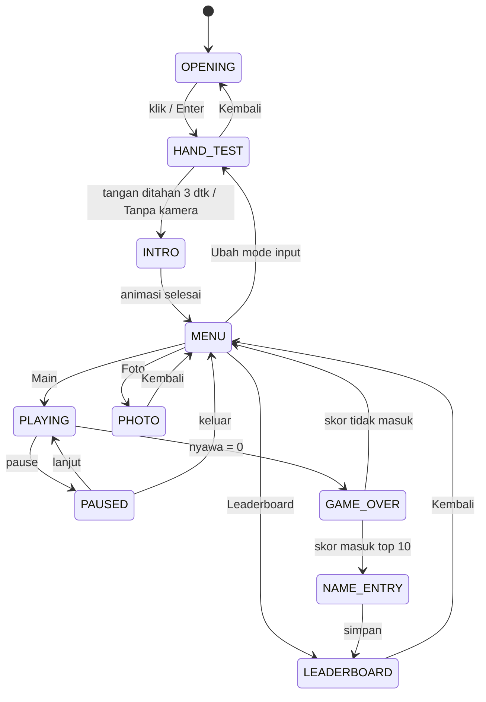

# ARCHITECTURE — Gravity Slash

|                |                 |
| -------------- | --------------- |
| **Versi**      | 0.1 (draft)     |
| **Tanggal**    | 4 November 2026 |
| **Mengacu ke** | `PRD.md` v0.1   |

---

## 1. Prinsip arsitektur

1. **Game loop di luar React.** Posisi orb dan jejak slash berubah puluhan kali per detik. React hanya mengurus layar, menu, dan HUD. Loop game berjalan di `requestAnimationFrame` dan menggambar ke `<canvas>`.
2. **Input lewat satu abstraksi.** Hand tracking dan mouse/touch menghasilkan data yang sama, sehingga game tidak tahu dari mana input datang.
3. **Logika game murni (tanpa DOM, tanpa React).** Generator soal, skor, spawn, dan tabrakan berupa fungsi/kelas biasa agar mudah diuji.
4. **Tanpa backend.** Situs statis. Data hanya di `localStorage`.
5. **Privasi.** Frame kamera diproses lokal dan tidak pernah dikirim atau disimpan.

## 2. Tech stack

| Kebutuhan                | Pilihan                                                        | Catatan                                                                                                                                                                                                                                                              |
| ------------------------ | -------------------------------------------------------------- | -------------------------------------------------------------------------------------------------------------------------------------------------------------------------------------------------------------------------------------------------------------------- |
| Framework UI             | React (JavaScript)                                             | Sesuai permintaan                                                                                                                                                                                                                                                    |
| Build tool               | Vite                                                           | Ringan untuk SPA statis                                                                                                                                                                                                                                              |
| Komponen animasi & latar | **Gratis: React Bits rasa JS-CSS** + efek original `GlyphRain` | Particles, Pattern Waves, Particle Text, Blur Text, Crosshair, Topography, Gradient ASCII, Ghost Fibers, Flux Lines. Dependensi pihak ketiga dicatat di sini **setelah sumber komponennya dibaca**, jangan menebak. **Wajib di-`import()` dinamis** agar tidak masuk bundel awal |
| Hand tracking            | `@mediapipe/tasks-vision` (Hand Landmarker)                    | `numHands: 2`, gunakan landmark 8                                                                                                                                                                                                                                    |
| Render game              | Canvas 2D                                                      | Cukup untuk orb, partikel, dan jejak                                                                                                                                                                                                                                 |
| State menu/game meta     | React Context + `useReducer`                                   | **Default.** Zustand hanya jika disetujui pemilik produk                                                                                                                                                                                                             |
| Audio                    | Web Audio API                                                  | **Default.** Howler hanya jika disetujui pemilik produk. Perlu gestur pengguna pertama                                                                                                                                                                               |
| Penyimpanan              | `localStorage`                                                 | Dibungkus service dengan penanganan error                                                                                                                                                                                                                            |
| Test                     | Vitest                                                         | Untuk logika murni                                                                                                                                                                                                                                                   |
| Lint/format              | ESLint + Prettier                                              |                                                                                                                                                                                                                                                                      |

> Versi paket tidak ditulis di sini. Ambil versi stabil terbaru saat instalasi dan catat di `package.json`.

**Aset MediaPipe disajikan dari `public/`, bukan CDN (NFR-07).** Selain `public/wasm/` dan `public/models/`, worker deteksi juga memuat bundel IIFE `public/vendor/vision_bundle.js` lewat `importScripts` (lihat 6.2). Bundel itu adalah salinan `node_modules/@mediapipe/tasks-vision/vision_bundle.js` yang dijaga tetap sinkron oleh `scripts/sync-vendor.mjs`, dijalankan otomatis lewat `postinstall`, `predev`, dan `prebuild`. Skrip melewati penulisan kalau isinya sudah sama supaya dev server tidak reload tanpa guna.

### 2.1 Dependensi nyata komponen React Bits (T-096)

Daftar ini dibaca dari **sumber tiap komponen** (commit `4dc7b5b`), bukan dari dokumentasi. Hanya paket yang benar-benar di-`import` yang dipasang.

| Komponen (folder di `src/components/reactbits/`) | Berkas              | `import` pihak ketiga                                      | Paket    |
| ------------------------------------------------ | ------------------- | ---------------------------------------------------------- | -------- |
| `Particles`                                      | `Particles.jsx`     | tidak ada (lebih dulu pakai `ogl`; versi ini murni kanvas) | —        |
| `PatternWaves`                                   | `PatternWaves.jsx`  | `ogl`                                                      | `ogl`    |
| `ParticleText`                                   | `ParticleText.jsx`  | tidak ada                                                  | —        |
| `BlurText`                                       | `BlurText.jsx`      | `motion/react`                                             | `motion` |
| `Crosshair`                                      | `Crosshair.jsx`     | tidak ada (kanvas 2D murni)                                | —        |
| `Topography`                                     | `Topography.jsx`    | tidak ada (kanvas WebGL2 murni)                            | —        |
| `GradientASCII`                                  | `GradientASCII.jsx` | tidak ada (kanvas WebGL2 + probe 2D)                       | —        |
| `GhostFibers`                                    | `GhostFibers.jsx`   | tidak ada (kanvas WebGL2 murni)                            | —        |
| `FluxLines`                                      | `FluxLines.jsx`     | tidak ada (kanvas WebGL2 murni)                            | —        |

`gsap`, `three`, `postprocessing`, `@react-three/fiber`, `meshline`, `maath`, dan `gl-matrix` **tidak dipakai** oleh kesembilan komponen ini, jadi tidak dipasang. `Topography`, `GradientASCII`, `GhostFibers`, dan `FluxLines` juga tidak menambah paket apa pun — keempatnya menggambar WebGL2 mentah; `GradientASCII` memakai kanvas 2D lebih dulu untuk memilih glyph lalu menggambar ke WebGL2. `GhostFibers` membangun rantai FBO + bloom sendiri, jadi hanya WebGL2 yang bisa menjalankannya.

`manualChunks` di `vite.config.js` memisahkan `ogl` dan `@mediapipe` ke chunk sendiri. `motion` **tidak** dipisah ke chunk sendiri — lihat bagian 14. Cara memuat tiap komponen disimpan terpusat di `src/components/reactbitsLoaders.js` (`LOADERS`, plus `SCREEN_CHUNKS` yang memetakan layar → chunk yang perlu dipanaskan). `Backgrounds.jsx` mengambil komponennya lewat `useBackdropComponent()` — **bukan `lazy()` + `<Suspense>`** — dan `Crosshair` pun diambil lewat jalur yang sama di `src/screens/HandTest.jsx` / `Opening.jsx` (ia overlay, bukan latar). Modul itu juga menyediakan `loadBackdrop()`, `preloadBackdrops()`, dan `preloadAllBackdrops()` untuk **memanaskan chunk lebih awal** dari layar pembuka (lihat 8.1). Semuanya agar tidak masuk bundel awal. `PatternWaves` tetap terdaftar di `LOADERS` dan tetap dibundel sebagai chunk malas walau Menu tidak lagi memakainya (lihat 8.1) — komponennya sengaja dipertahankan, bukan dihapus.

## 3. Gambaran lapisan

```
┌────────────────────────────────────────────────────────┐
│  UI LAYER (React)                                      │
│  Screens · HUD · Menu · Leaderboard · Overlay flash    │
└───────────────▲───────────────────────┬────────────────┘
                │ state ringan          │ perintah (start, pause)
                │ (skor, nyawa, soal)   ▼
┌───────────────┴────────────────────────────────────────┐
│  GAME ENGINE (JS murni)                                │
│  loop · spawner · physics · collision · scoring · soal │
│  renderer (Canvas 2D) · partikel · jejak slash         │
└───────────────▲────────────────────────────────────────┘
                │ pointers[] ternormalisasi
┌───────────────┴────────────────────────────────────────┐
│  INPUT LAYER                                           │
│  InputManager                                          │
│   ├─ HandTrackingAdapter (MediaPipe, kamera)           │
│   └─ PointerAdapter (mouse / touch)                    │
└────────────────────────────────────────────────────────┘

Services (dipakai lintas lapisan): storage · audio · config
```

## 4. Mesin status layar



Status layar disimpan di store UI. Hanya komponen layar aktif yang dirender.

## 5. Struktur folder (usulan)

```
repo-root/
├─ AGENT-FILES/          # semua dokumen (satu lokasi, tidak disalin)
├─ scripts/
│  └─ sync-vendor.mjs    # salin vision_bundle.js ke public/vendor/ (postinstall/predev/prebuild)
├─ public/
│  ├─ models/            # hand_landmarker.task (disajikan lokal)
│  ├─ wasm/              # file wasm MediaPipe
│  ├─ vendor/            # vision_bundle.js (IIFE, dimuat worker via importScripts)
│  ├─ fonts/             # font self-host + lisensi
│  └─ audio/             # + CREDITS.md (sumber & lisensi)
├─ src/
│  ├─ main.jsx
│  ├─ App.jsx            # router layar berdasarkan state
│  ├─ config/
│  │   └─ gameConfig.js  # semua angka game (nyawa, skor, spawn, dll.)
│  ├─ screens/
│  │   ├─ Opening.jsx    # layar pembuka: wordmark + petunjuk klik, latar Ghost Fibers (T-098, T-140)
│  │   ├─ HandTest.jsx   # uji tangan: crosshair + hover + tahan 3 dtk untuk mulai
│  │   ├─ Intro.jsx       # intro GRAVITY SLASH + aturan + bilah progres (T-142)
│  │   ├─ Menu.jsx
│  │   ├─ Game.jsx       # mount canvas + HUD
│  │   ├─ GameOver.jsx
│  │   ├─ NameEntry.jsx  # input nama sebelum simpan skor
│  │   ├─ Leaderboard.jsx
│  │   └─ Photo.jsx      # layar Foto/selfie: kamera sendiri + efek (PRD 14)
│  ├─ components/
│  │   ├─ reactbits/     # React Bits gratis rasa JS-CSS (disalin apa adanya; jangan ubah isinya)
│  │   ├─ Backgrounds.jsx # pembungkus backdrop + fallback statis; `useBackdropComponent` + `BackdropLayer` (T-087, T-088, T-095, T-138, T-140, T-143)
│  │   ├─ reactbitsLoaders.js # registri pemuat dinamis + `useBackdropComponent`/`preloadBackdrops` (BUG-013, BUG-018)
│  │   ├─ ErrorBoundary.jsx
│  │   ├─ DevShortcuts.jsx # Alt+1..9 + Alt+0 pindah layar (hanya DEV)
│  │   ├─ Hud.jsx
│  │   ├─ FlashOverlay.jsx
│  │   ├─ CameraPreview.jsx # pratinjau kamera, useCameraStream/useCameraPreview, CameraStage
│  │   ├─ SlashCursor.jsx  # jejak iris dekoratif (canvas 2D)
│  │   └─ GlyphRain.jsx  # efek original (canvas 2D), bukan React Bits
│  ├─ engine/            # TANPA import React
│  │   ├─ GameEngine.js  # loop, siklus hidup, event
│  │   ├─ Spawner.js
│  │   ├─ Orb.js
│  │   ├─ collision.js   # segmen vs lingkaran
│  │   ├─ scoring.js
│  │   ├─ questions.js   # generator soal + distraktor
│  │   ├─ renderer.js
│  │   ├─ particles.js
│  │   └─ photoStudio.js # kompositor foto 1080×1080 (murni, tanpa React)
│  ├─ input/
│  │   ├─ InputManager.js
│  │   ├─ HandTrackingAdapter.js
│  │   ├─ handWorker.js   # deteksi MediaPipe di Web Worker klasik (BUG-008)
│  │   ├─ PointerAdapter.js
│  │   ├─ smoothing.js
│  │   └─ slashTrail.js
│  ├─ services/
│  │   ├─ storage.js     # leaderboard + snapshot sesi terakhir
│  │   ├─ share.js       # unduh/bagikan foto (Web Share API + fallback)
│  │   └─ audio.js
│  ├─ state/
│  │   ├─ screens.js     # daftar nama layar + mode input
│  │   └─ uiStore.jsx    # React Context + useReducer (tanpa Zustand)
│  ├─ styles/
│  │   ├─ tokens.css     # warna, tipografi, spacing
│  │   ├─ global.css     # reset + dasar
│  │   └─ ui.css         # gaya layar, HUD, overlay, leaderboard
│  └─ utils/
│      ├─ env.js         # reduced-motion, deteksi WebGL, baca token, swipe
│      ├─ handPointer.js # deteksi tangan non-permainan: hover + kunci bidik (T-141)
│      └─ webglStrictModeGuard.js # dev-only: jaga latar WebGL dari pembersihan palsu StrictMode (BUG-016)
```

## 6. Input layer

### 6.1 Kontrak data

Semua adapter menghasilkan daftar pointer ternormalisasi (0–1, relatif ke area game, sudah di-mirror untuk kamera):

```js
// dipanggil tiap frame
pointers = [
  { id: 'hand-0', x: 0.42, y: 0.31, t: 1730000000000, active: true },
  { id: 'hand-1', x: 0.77, y: 0.55, t: 1730000000000, active: true },
];
```

Maksimal 2 elemen. `InputManager` menjamin batas ini, apa pun adapternya.

### 6.2 HandTrackingAdapter

1. Minta kamera lewat `getUserMedia` dengan resolusi ideal dari `gameConfig.hand.camera` (`1280×720`) dan, lewat `advanced`, `exposureMode`/`whiteBalanceMode`/`focusMode` `'continuous'` (BUG-022: backlight membuat tangan jadi silhouette; constraint yang tidak didukung diabaikan). Resolusi tinggi penting: pada jarak 1–1,5 m tangan hanya menempati porsi kecil frame, jadi frame yang lebih besar menyimpan lebih banyak detail sebelum MediaPipe mengecilkannya ke ukuran input tetap (BUG-011).
2. Inisialisasi `HandLandmarker` dengan `numHands: 2`, mode `VIDEO`, dan ambang keyakinan dari `gameConfig.hand.confidence` (`minHandDetectionConfidence`, `minHandPresenceConfidence`, `minTrackingConfidence` = `0,3`; bawaan `0,5` terlalu ketat untuk tangan jauh). Setiap frame video, ambil **landmark 8** dari tiap tangan.
3. **Inferensi berjalan di Web Worker** (`src/input/handWorker.js`), bukan di main thread. `detectForVideo` memblokir thread pemanggilnya ~20 ms; di main thread itu ±48% dari setiap detik pada 24 Hz dan animasi tersendat (BUG-008). Worker menerima `ImageBitmap` yang dialihkan (transfer), mengembalikan hanya landmark 8, lalu menutup bitmap itu. Main thread hanya membayar `createImageBitmap` (±0,1 ms).
4. **Worker harus worker klasik** (bukan `type: 'module'`). Vite menulis ulang setiap `import()`, termasuk yang dinamis, sehingga pemuat wasm MediaPipe di `public/` gagal dimuat di mode pengembangan. `importScripts('/vendor/vision_bundle.js')` adalah pemanggilan biasa yang tidak disentuh Vite, jadi jalur ini sama di dev dan build. Karena itu bundel tasks-vision disalin ke `public/vendor/` oleh `scripts/sync-vendor.mjs`.
5. **Backpressure satu permintaan sekaligus.** Selama worker belum menjawab, frame berikutnya tidak dikirim; tanpa ini `ImageBitmap` menumpuk dan memori meledak. `detectHz` 45 adalah **batas atas, bukan paksa**: worker melaporkan biaya inferensi tiap frame (`ms`) dan adapter menyesuaikan jeda (`adaptInterval`). Bila satu inferensi lebih mahal dari `inferenceBudget` × jeda, laju **turun cepat** (sampai `minDetectHz` 15); saat kembali murah, laju **naik pelan** (hanya bila target < 85% jeda sekarang) supaya tidak berayun. Tanpa tangan selama `idleAfterMs`, laju turun ke `idleDetectHz` 10 agar CPU/baterai tidak terbakar. Dinaikkan 30 → 45 pada revisi 4 Nov 2026 atas permintaan pemilik produk ("lebih cepat"), lalu dibuat adaptif 7 Nov 2026 karena 45 Hz di mesin lambat justru membuat gerakan tersendat (BUG-020).
6. **Delegate worker: `CPU` (XNNPACK).** Pengukuran: GPU 19,86 ms vs CPU 20,79 ms di Metal — tidak lebih cepat — dan GPU jauh lebih lambat di mesin tanpa akselerasi nyata (SwiftShader 234 ms). Karena sudah di thread terpisah, CPU selalu cukup (≈20 ms per slot 33 ms). Kalau worker gagal disiapkan dalam `workerReadyTimeoutMs`, adapter **kembali ke jalur cadangan main thread** (dimuat malas lewat `import()`), dan di sana delegate tetap dipilih dari hasil pengukuran: coba `GPU` lalu `CPU`, panaskan tiap kandidat `warmupFrames` frame (panggilan pertama memuat shader dan tidak dihitung), lalu tolak kandidat di atas `maxInferenceMs`.
7. **Worker dan jalur cadangan berbagi satu jalur pemrosesan** (`ingestTips`): saring kualitas, mirror sumbu X, beri `id`, haluskan (EMA), lalu tulis ke `InputManager`. Keduanya wajib berperilaku identik. `pipeline` melaporkan jalur yang aktif (`'worker'` / `'main-thread'` / `'none'`).
   Sebelum menjadi pointer, tiap tangan melewati **penyaring deteksi palsu** (BUG-020): skor `handedness` ≥ `minHandScore` 0,25, panjang telapak (pergelangan → MCP jari tengah) ≥ `minPalmSize` 0,012, dan `reach` (jarak ujung telunjuk dari pergelangan ÷ jarak MCP telunjuk, 2D) di antara `minIndexReach` 1,15 dan `maxIndexReach` 3,6. Tujuannya menolak kerangka tangan yang dipasang MediaPipe di lengan bawah saat telapak tidak terlihat. Penyaring memakai **histeresis** `qualityGraceMs` 350 ms: tangan yang sedang terlacak tidak langsung hilang saat satu-dua frame gagal. Posisi hasil meragukan dipakai kalau tidak melompat lebih jauh dari `graceMaxJump` (0,15; blur gerakan cepat masih dekat), dan dibekukan kalau melompat jauh (kemungkinan lengan). Kualitas buruk berkelanjutan baru dihapus lewat `staleHoldMs`. `z` tidak dipakai karena berisik dan membuat rasio berayun.
8. Beri `id` stabil per tangan. Deteksi baru dicocokkan dengan **posisi ramalan** tangan sebelumnya (posisi mentah terakhir + kecepatan × waktu, dibatasi `predictMaxSec` 0,2 dtk) dan semua pasangan diurutkan jaraknya (pencocokan global), bukan mengikuti urutan keluaran MediaPipe. Ambangnya `idMatchRadius` 0,5. Tanpa ramalan + pencocokan global, deteksi palsu yang masih di posisi lama (lengan, tangan kedua, objek serupa) bisa mencuri id sehingga kursor tertinggal di situ (BUG-021). Selain itu ada **kursor utama terkunci** (`primaryId`): id yang sudah menjadi kursor dipertahankan selama tangannya terlihat, dan layar non-permainan memakai `primaryId`, bukan `pointers[0]`.
9. `start()` bersifat **dapat dibatalkan**: ia menyimpan token `generation` yang dinaikkan setiap `stop()`. `start()` yang masih berjalan (menunggu izin kamera atau memuat model) membatalkan diri dan menutup kamera/model yang baru dibuka. Tanpa ini, pemasangan ganda React StrictMode meninggalkan dua aliran kamera hidup dan dua loop inferensi — pengganda beban main thread yang tidak terlihat.
10. Pointer tidak dibuang pada satu deteksi yang meleset. Tiap id tangan punya `staleHoldMs` (200 ms). Selama deteksi kosong (mis. blur saat menyapu cepat), pointer **dilanjutkan** mengikuti kecepatan terakhir selama `coastMaxMs` (120 ms), diredam `coastDamping` (0,5) supaya tidak meluncur sendiri saat tangan mendadak berhenti; baru setelah `staleHoldMs` pointer dihapus. Kecepatan dihitung dari dua sampel terakhir per id (`motion`). Pencocokan id memakai `idMatchRadius` 0,5 supaya lompatan sampel saat menyapu cepat tidak mereset penghalusan/kecepatan. Kehadiran tangan (`handPresent`, untuk auto-pause) memakai jendela `presentWindowMs` (280 ms) yang lebih longgar dari jarak antar deteksi.
11. Semua angka tuning langkah di atas hanya ada di `gameConfig.js` bagian `hand`: `maxHands`, `camera` (resolusi ideal), `confidence` (ambang keyakinan), `lostGraceMs`, `detectHz` (batas atas) + `inferenceBudget`/`minDetectHz`/`idleDetectHz`/`idleAfterMs` (laju adaptif), `minHandScore`/`minPalmSize`/`minIndexReach`/`maxIndexReach`/`qualityGraceMs`/`graceMaxJump`/`idMatchRadius`/`predictMaxSec`/`coastMaxMs`/`coastDamping` (penyaring + kesinambungan gerak cepat + penguncian identitas), `emitMinMovePx`/`emitHeartbeatMs` (emisi pointer), `smoothingAlpha`/`smoothingTauMs` (penghalus pointer; bobot EMA dihitung dari waktu, jadi 30 fps dan 45 fps sama halus), `delegate`, `workerReadyTimeoutMs`, `presentWindowMs`, `staleHoldMs`, `warmupFrames`, `maxInferenceMs`. Target rasa yang disetujui pemilik produk adalah **"respons cepat"**, bukan "halus maksimal": karena itu `detectHz` (45) dinaikkan dan `smoothingAlpha` (0,6) sedikit diturunkan supaya gerakan terasa lebih rapat mengikuti tangan. Sejak 8 Nov 2026 bobot EMA dihitung dari `dt` dan `smoothingTauMs` (40 ms), bukan jumlah sampel, karena feed lewat OBS Virtual Camera hanya 30 fps.
12. **Emisi pointer untuk layar non-permainan dibatasi** (`useHandPointer`). Adapter memperbarui posisi 15–45×/detik, tetapi menyuntik `pointermove` ke elemen di bawah telunjuk hanya saat posisi bergeser ≥ `emitMinMovePx` (0,75 px) atau tiap `emitHeartbeatMs` (60 ms). Tanpa ambang ini event dikirim 60×/detik walau tangan diam: `Crosshair` tidak pernah "tenang", kanvas terus digambar ulang, dan hover terasa tersendat. Detak 120 ms lebih pendek dari pengawas `useHoldTarget` (250 ms) sehingga hover-tahan tetap hidup. `pointerleave` tidak dikirim pada satu frame kosong; modul menunggu `handPresent` (jendela `presentWindowMs` 280 ms) lewat, supaya crosshair dan baris status tidak berkedip (BUG-023). Manfaat yang sama didapat dari penulisan bilah tahan yang hanya dilakukan saat progres berubah ≥ 0,004.

> Adapter ini **dipakai ulang di luar layar Game**: `src/utils/handPointer.js` (`useHandPointer`) menjalankannya di layar **idle** supaya ujung telunjuk bisa menggerakkan crosshair sebelum bermain (T-141). Sama seperti layar Game, ia menerima `onStatus` dan berbagi `InputManager`; bedanya modul itu hanya membaca posisi untuk hover, tidak pernah mengubahnya menjadi klik.

### 6.3 PointerAdapter

- Mouse: `pointerdown` / `pointermove` / `pointerup`. Aktif saat tombol ditekan.
- Touch: maksimal 2 `pointerId` aktif.
- Hasil dikonversi ke kontrak yang sama.

### 6.4 Slash trail dan deteksi iris

- Tiap pointer menyimpan riwayat posisi beberapa frame terakhir sebagai jejak visual.
- Iris dihitung per frame sebagai **segmen** dari posisi sebelumnya ke posisi sekarang, diuji terhadap lingkaran orb (`collision.js`).
- Iris hanya sah jika kecepatan segmen **di atas ambang** (nilai di `gameConfig`).
- Orb yang sudah teriris ditandai `sliced = true` dan tidak diuji lagi.

### 6.5 Sistem koordinat (wajib, jangan diubah)

Semua pihak harus berbicara dalam **satu ruang koordinat yang sama**. Ini yang menghilangkan risiko R-11:

1. **Pointer** masuk sebagai nilai ternormalisasi `0–1` relatif ke area game.
2. **Orb** disimpan dan diuji dalam ruang ternormalisasi yang sama: `x`, `y` bernilai `0–1`, `radius` adalah fraksi lebar layar.
3. **Piksel, `devicePixelRatio`, dan resize hanya ditangani di `renderer.js`** saat menggambar — tidak ada di engine.
4. `gameConfig.physics` ditulis dalam satuan ternormalisasi (mis. gravitasi ≈ `0.9` per detik²), **bukan piksel**.
5. Saat resize, tidak ada objek game yang perlu dipindahkan, karena semuanya sudah ternormalisasi.

## 7. Game engine

### 7.1 Siklus

```
init(config, canvas)
start() → countdown 5 detik → loop:
   dt = waktu sejak frame sebelumnya (dibatasi maksimum)
   pointers = input.read()
   update(dt, pointers)   // spawn, fisika, tabrakan, aturan skor
   render()               // canvas
   emit events ke UI (throttle)
stop() / pause() / resume() / restart()
```

`dt` selalu dipakai dalam fisika agar kecepatan tidak bergantung pada FPS. Engine otomatis pause saat **tab tidak aktif** dan saat **tangan hilang dari frame** (mode hand tracking); timer soal juga berhenti selama pause.

### 7.2 Model data inti

```js
// Orb
{
  id, kind: 'answer' | 'bomb' | 'heal',
  value: 56 | null,          // hanya untuk 'answer'
  isCorrect: true | false,   // hanya untuk 'answer'
  x, y, vx, vy, radius, rotation,
  sliced: false
}

// Soal
{ text: '7 × 8', answer: 56, op: '×' }

// State inti engine
{ status, lives, score, combo, multiplier, question, orbs[], correctStreak }
```

### 7.3 Event dari engine ke UI

| Event              | Data                                                          | Dipakai untuk                                  |
| ------------------ | ------------------------------------------------------------- | ---------------------------------------------- |
| `scoreChanged`     | `score`, `combo`, `multiplier`                                | HUD                                            |
| `livesChanged`     | `lives`                                                       | HUD, animasi nyawa                             |
| `questionChanged`  | `question`                                                    | Teks soal di tengah layar                      |
| `feedback`         | `type: 'correct' \| 'wrong' \| 'bomb' \| 'heal' \| 'timeout'` | Flash overlay, suara                           |
| `sliced`           | `at`, `kind`                                                  | Efek suara slash untuk setiap orb yang teriris |
| `timerChanged`     | `remainingMs`, `totalMs`                                      | Bilah waktu di HUD                             |
| `countdownChanged` | `remainingSec`                                                | Overlay countdown 5 detik sebelum soal pertama |
| `gameOver`         | `score`                                                       | Pindah layar                                   |

UI melakukan _subscribe_ ke event dan menyimpan hanya nilai yang perlu dirender ulang. Posisi orb **tidak** masuk state React.

### 7.4 Aturan skor (`scoring.js`)

Fungsi murni, mudah diuji:

```js
applyCorrect(state); // +10 * pengali, combo naik
applyWrong(state); // -5, minimum 0, combo reset
applyBomb(state); // lives - 1
applyHeal(state); // lives + 1, maksimum 3
applyQuestionFailed(state); // timer habis ATAU orb benar lolos: combo reset, lives - 1 (PRD 5.5)
clearOrbs(state); // tandai semua orb lama sliced saat soal berganti
```

Semua angka dibaca dari `gameConfig.js`.

### 7.5 Generator soal (`questions.js`)

- Menghasilkan soal sesuai operasi dan rentang dari config.
- Memastikan hasil bulat, tidak negatif, pembagian habis.
- Membuat distraktor: mulai dari jawaban benar, ambil kandidat dari `answer ± {1, 2, 3, 10%}` dan variasi kesalahan umum (mis. salah satu langkah tabel perkalian). Saring: unik, `>= 0`, tidak sama dengan jawaban benar, dan untuk pembagian hasil kali balik tetap bulat. Jika kandidat kurang, perluas rentang sampai jumlah cukup.
- Menerima _seed_ opsional agar pengujian deterministik.

### 7.6 Renderer

- Satu canvas layar penuh, `devicePixelRatio` ditangani.
- Urutan gambar: latar → orb → partikel → jejak slash → (UI React di atas canvas).
- Teks angka pada orb digambar dengan kontras tinggi dan ukuran minimum agar terbaca saat bergerak.
- Hindari alokasi objek baru tiap frame di jalur panas. Pakai _object pool_ untuk partikel **hanya jika** T-114 menunjukkan masalah alokasi.

### 7.7 Daur hidup orb

- Orb hanya sah dinilai selama `questionId`-nya sama dengan soal aktif.
- Saat soal berganti (benar, salah, gagal, atau timeout): semua orb lama ditandai `sliced = true`, memudar ±250 ms, lalu dihapus. Iris setelah itu tidak mengubah skor.
- Orb yang keluar dari bawah layar dihapus. Orb jawaban benar yang keluar layar tanpa diiris memicu **soal gagal**.

## 8. UI layer (React)

- `App.jsx` memilih layar dari store (layar awal `OPENING`).
- `Game.jsx` memasang canvas dan membuat `GameEngine` di `useEffect`, lalu membersihkannya saat dilepas.
- `Hud.jsx` menampilkan nyawa, skor, combo, soal, bilah waktu timer, dan tombol mute. Soal tampil di tengah layar.
- `FlashOverlay.jsx` menampilkan flash warna dan teks "JAWABAN SALAH" berdasarkan event `feedback`.
- Komponen React Bits berada di `components/reactbits/` dan **tidak diubah isinya**. Pembungkus (wrapper) dibuat di luar folder itu bila perlu penyesuaian. Aturan gaya proyek dimatikan khusus folder ini di `eslint.config.js` (termasuk `no-useless-assignment`), jadi berkasnya tetap identik byte-per-byte dengan sumber — tidak ada tambalan komentar `eslint-disable` di dalam komponen.
- Warna, tipografi, dan spacing diambil dari `styles/tokens.css`.

### 8.1 Pembuka, uji tangan, dan intro (revisi 7 Nov 2026)

- `Opening.jsx` (F7 T-098) adalah layar **pertama**: wordmark **GRAVITY SLASH** di atas **Ghost Fibers** dan **Crosshair**. Sejak revisi lanjutan 7 Nov 2026 **kamera diminta di sini** (bukan di layar uji): `useHandPointer({ enabled: true })` menyala saat komponen dipasang, pratinjau kecil tampil di bawah wordmark, dan status kamera (`siap`/`ditolak`) ditulis ke `uiStore`. Begitu kamera siap, mode input menjadi `HAND` (`setMode`), jadi layar uji langsung memakai kamera tanpa bertanya dua kali. Mulai = **menahan bidik di wordmark** selama `CONFIG.hand.confirmHoldMs` (3 detik) lewat `useHoldTarget` (`.opening__start`); bilah pink mengisi di rAF tanpa render React. **Klik tetap memulai** (jalur cadangan mouse), dan Enter/Space langsung mulai karena menahan tombol keyboard 3 detik tidak nyaman. **Peringatan privasi kamera** ada di bagian bawah layar (`.opening__privacy`, alur dokumen, bukan `position: absolute`, jadi tidak menimpa pratinjau). Teksnya diberi selubung `color-mix(--bg 82%)` supaya kontras tetap AA di atas serat yang bergerak.
- Layar pembuka juga **memanaskan chunk animasi** lewat `preloadAllBackdrops()` di dalam `requestIdleCallback` (BUG-013). Tanpa ini komponen baru di-`fetch` saat tirai membuka. Selain itu, setiap perpindahan layar memanaskan chunk **layar tujuan** selagi tirai menutup (`preloadBackdrops(...SCREEN_CHUNKS[screen])` di `App.jsx`) — lihat butir "Tirai antar-layar" di bawah. Dilewati saat `prefers-reduced-motion` atau WebGL tidak ada. `patternWaves` tetap terdaftar di `LOADERS` (tidak dihapus) walau tidak dipakai di jalur utama.
- `HandTest.jsx` adalah layar **uji tangan** (pengganti `CameraGate` + `IdleGlobe`, permintaan pemilik produk 7 Nov 2026). Ia memasang latar **Topography** (React Bits gratis) — satu-satunya latar animasi di layar ini — plus **Crosshair** sebagai overlay kursor (`pointer-events: none`, bukan latar, jadi tidak menambah latar aktif). `color` disuplai sebagai nilai nyata dari `readToken('--color-pink')` karena `ctx.fillStyle` tidak menerima `var()`.
- Alur layar: **Pembuka → Uji tangan → Intro (loading) → Menu**. Tidak ada lagi layar idle terpisah. Privasi pindah ke pembuka, jadi layar uji tidak menampilkan daftar privasi.
- **Hover tangan di layar uji (T-141).** Saat mode kamera, `src/utils/handPointer.js` (`useHandPointer`) menjalankan `HandTrackingAdapter` yang **sama** dengan gameplay, jadi ujung telunjuk menggerakkan crosshair dan mengunci wordmark/tombol. Pratinjau kamera memakai elemen video milik adapter itu (satu stream, bukan dua). Modul ini **tidak pernah** mengirim `pointerdown`/`pointerup`/`click`, dan **tidak** menerjemahkan lambaian cepat menjadi "mulai"; ia hanya menyuntik `pointermove` asli ke elemen di bawah ujung telunjuk, jadi tombol tidak bisa terpicu oleh tangan — persis "hover ngetes doang, gabisa klik".
- **Mulai dengan menahan di tombol Lanjut.** Hover bebas dipakai untuk menguji bidik; aksi mulai ada di tombol **Lanjut** (`[data-crosshair-target]`) yang harus ditahan `CONFIG.hand.confirmHoldMs` (3 detik). `useHandPointer` melaporkan `present`; `useHoldTarget` di `src/utils/useHoldTarget.js` mengisi bilah pink lewat ref di rAF tanpa render React. Saat ada tangan di frame, berhenti di atas tombol sudah dihitung menahan; tanpa tangan, tombol harus ditekan dan ditahan (mouse/sentuh), dan klik biasa juga langsung lanjut. Tangan hilang atau bidik keluar tombol → bilah kembali ke nol. Penuh → `goTo(INTRO)`. Menahan di satu target dipilih supaya lambaian tak sengaja tidak memulai permainan.
- **Jalur tanpa kamera & kembali.** Tombol **Tanpa kamera** memanggil `setMode(POINTER)` lalu `goTo(INTRO)`. Tombol **Kembali ke layar pembuka** mematikan stream (adapter dilepas saat unmount) dan kembali ke `OPENING`; izin kamera yang sudah diberikan tidak ditanyakan lagi. Menu punya tautan **Ubah mode input** ke layar ini dan **Kembali ke layar pembuka** (khusus demo, kembali ke layar pertama tanpa memuat ulang halaman).
- **Galat kamera** memakai `gate__status` dengan `role="alert"`, dan tombol **Coba lagi** menaikkan `retryKey` di `useHandPointer` supaya adapter (stream baru) dipasang ulang.
- **Layout.** Bilah tahan memakai `.hold-meter__track`/`__fill` (dipakai di dalam tombol pembuka dan tombol Lanjut; bukan kelas khusus satu layar). Terukur `probe-hold-layout.mjs` di 1440×900/834×1194/390×844/844×390/320×640: pembuka dan layar uji **0 overflow, 0 anak terpotong, 0 error konsol**; peringatan privasi tidak menabrak tombol mulai maupun pratinjau. Di jendela pendek (lanskap ≤560 px) teks+tombol layar uji pindah ke kiri dan pratinjau ke kanan, sedangkan bingkai kamera pembuka disembunyikan (bidik tetap terlihat lewat crosshair) agar wordmark + bilah + privasi muat dalam 390 px.
- Perilaku menahan (hover tangan maupun klik-tahan) sudah diuji headless lewat event pointer buatan; tahan dengan **tangan sungguhan** belum bisa diuji tanpa kamera nyata.
- Catatan biaya: karena kamera dan model deteksi sekarang dimulai di layar pertama, `vendor/vision_bundle.js` + model ikut dimuat lebih awal daripada sebelumnya. Ini konsekuensi langsung permintaan "izin kamera dari awal" dan perlu dicek ulang di jaringan lambat bila LCP jadi keluhan.
- Layar **Intro** (T-142) ditata ulang supaya tidak terbaca seperti layar loading: komposisinya ditengahkan dan diperbesar (judul partikel di atas, aturan bernomor besar, bilah progres 6 px pink, tombol **Lewati** nyata), dengan selubung lembut di belakang konten untuk menjaga kontras di atas bidang dekoratif. Judul tetap **Particle Text** yang beranimasi; `prefers-reduced-motion` tetap memakai judul statis dan durasi singkat.
- Layar **Intro** berperan sebagai **loading**: `Intro.jsx` memutar teks **GRAVITY SLASH** dengan **Particle Text** beserta tiga aturan, lalu pindah ke `MENU` setelah ±8 detik (atau lewat tombol **Lewati**).
- **Menu** (T-141, revisi 6 Nov 2026) memakai **dua kolom** di layar lebar — kolom kiri identitas + aksi, kolom kanan panel papan skor; di bawah 860px kembali satu kolom bertumpuk. Rincian di bagian 8.4.
- Latar layar lain: **Ghost Fibers** di `MENU`, **GlyphRain** di `LEADERBOARD`, **Topography** di `HAND_TEST`, **Flux Lines** di `GAME_OVER`, **GradientASCII** di `NAME_ENTRY`, dan **Blur Text** untuk teks di `GAME_OVER`.
- **Flux Lines** (T-143) adalah latar layar `GAME_OVER`: aliran garis violet→pink yang **bergerak terus**, dibungkus `FluxLinesBackdrop()` di `Backgrounds.jsx`. Ia menggantikan Gradient ASCII `eclipse` yang gradiennya tenang sehingga pemain mengira layar diam dan bingung "ini apa" (revisi pemilik produk, 4 Nov 2026). Butuh WebGL2 seperti Topography/Ghost Fibers; `prefers-reduced-motion` atau WebGL gagal → fallback statis `.backdrop--flux` + scrim `::after`.
- **Tirai antar-layar tidak boleh membuka ke latar yang belum siap (BUG-018).** Berkas ini dulu memakai `lazy()` + `<Suspense>` untuk setiap komponen. React selalu **menangguhkan render pertama** komponen `lazy` dan baru mencoba ulang ~300 ms kemudian, jadi saat layar baru dipasang tepat ketika tirai membuka, pemain sempat melihat latar statis lebih dulu lalu kanvasnya "muncul mendadak" di tengah animasi — kedutan yang dilaporkan pemilik produk. Sekarang `reactbitsLoaders.js` **menyimpan komponen yang sudah dimuat** (`getBackdropComponent` / `loadBackdrop`) dan `App.jsx` memanggilnya selagi tirai menutup, sehingga `useBackdropComponent()` mengembalikan komponennya pada render **pertama** layar baru dan kanvas masuk DOM di frame yang sama dengan pergantian layar. Terukur di build produksi: kanvas latar layar baru masuk DOM ~300 ms setelah layarnya dipasang dengan `lazy`, dan **0 ms** setelah perbaikan (commit frame yang sama dengan reveal). Diperiksa ulang 5 Nov 2026 mencakup **seluruh layar** (saat itu masih CameraGate/IdleGlobe, kini Uji tangan, Intro, Menu, Game, Game Over, NameEntry, Leaderboard, Photo): tiap segmen reveal punya **0 frame tanpa latar**, `bgFirst=1` untuk semua layar yang memang punya latar, jeda frame terbesar 57 ms. Layar yang tanpa latar (Intro, Game, Photo) memang begitu menurut desain/aturan, jadi `bgFirst=−1` di sana bukan cacat. Karena identitas komponennya stabil dari cache modul, ia diteruskan **sebagai prop** ke `BackdropLayer` (modul-scope) supaya aturan lint `react-hooks/static-components` tetap berguna tanpa dimatikan.
- **Ghost Fibers** (T-140) adalah latar paling "ramai" yang dipakai aplikasi: serat cahaya violet→pink yang melipat, dibungkus `GhostFibersBackdrop({ variant })` di `Backgrounds.jsx`. Hanya dua layar non-permainan yang memakainya dan masing-masing memakai setelan berbeda supaya tidak kembar — `opening` paling terang/cepat, `menu` sedikit lebih tenang agar teks dan tombol tetap terbaca. Karena rantai bloom-nya berat (bilah × titik × lapisan), `threads`, `density`, dan `dpr` ditahan di bawah bawaan. Sama seperti Topography dan Gradient ASCII, ia butuh WebGL2; `prefers-reduced-motion` atau WebGL gagal → fallback statis `.backdrop--fibers`, jadi lapisan ini tidak pernah kosong saat gerbang itu menolak. (Browser yang hanya punya WebGL1 tetap lolos `hasWebGL` dan kanvasnya merender kosong — keterbatasan laten yang sama dengan Topography, sudah ada sebelum komponen ini.) Berbeda dari Topography/Gradient ASCII, scrim `::after` latar ini **sengaja longgar** (hanya vignette tepi, tanpa lapisan perata) supaya warna serat tidak pudar; revisi pemilik produk juga menaikkan `glow`/`sparkle`/`particles`/`brightness` dan memakai `gradient` `across`/`along` agar untaian terbaca dua warna.
- **Topography** dan **GradientASCII** (putaran ketujuh, T-138) adalah komponen WebGL2 mentah tanpa dependensi pihak ketiga. Keduanya dibungkus di `Backgrounds.jsx` — `TopographyBackdrop()` (warna `violetLift`, garis kontur tipis) dan `AsciiBackdrop({ shape })` (`eclipse` di `GAME_OVER`, `rise` di `NAME_ENTRY`; warna `[violet, pink, putih]`). Karena WebGL2 bisa tidak ada, setiap pembungkus **selalu** memakai pembungkus `.screen__bg` baik saat animasi jalan maupun saat jatuh ke fallback: gradien CSS statis (`.backdrop--topography`, `.backdrop--ascii`) plus lapisan `::after` sebagai scrim, jadi lapisan latar tidak pernah kosong dan kontras teks tetap aman. `prefers-reduced-motion` selalu memakai fallback statis (0 kanvas).
- **Kompatibilitas WebGL ↔ StrictMode (BUG-016).** Komponen React Bits melepas konteks WebGL-nya di pembersih efek lewat `WEBGL_lose_context.loseContext()`; karena `<StrictMode>` memasang efek dua kali di dev, pemasangan kedua memakai konteks yang sudah mati dan latar tampak kosong. `src/utils/webglStrictModeGuard.js` (dipanggil dari `main.jsx`, hanya aktif di `import.meta.env.DEV`) mengabaikan `loseContext()` yang datang **saat kanvas masih tercantum di dokumen** — pembersihan asli saat layar dilepas tetap jalan karena React sudah mencabut kanvas lebih dulu. Isi komponen React Bits tidak disentuh.
- Setiap komponen animasi di-`import()` dinamis, dilepas saat layarnya tidak aktif, dan punya versi reduksi untuk `prefers-reduced-motion`.
- Tidak ada latar animasi di layar `GAME`.

### 8.2 Layar Foto (F11, PRD 14)

- `Photo.jsx` membuka stream kamera sendiri lewat `useCameraStream` (tanpa MediaPipe) dan menutupnya saat dilepas; tidak ada frame yang dikirim atau disimpan (AGENTS.md 7.10).
- `CameraStage` menempelkan elemen video ke bingkai persegi; filter pratinjau dipasang sebagai gaya bingkai, bukan dengan mengubah elemen video (aturan immutability React Compiler).
- Komposisi akhir digambar `engine/photoStudio.js` ke kanvas 1080×1080 (crop cover, mirror sumbu X), lalu diunduh atau dibagikan lewat `services/share.js`.
- Latar animasi layar **tidak** dipakai di sini; "latar animasi" hanyalah salah satu pilihan efek yang dibakar ke dalam foto.
- Hitung mundur, status hasil, dan pesan kesalahan diumumkan lewat `aria-live`; denyut angka dimatikan saat `prefers-reduced-motion`.

### 8.3 Kompatibilitas mobile & tablet (FR-16, bonus B-01)

Desktop tetap target utama, tetapi layout kini aman di tablet (iPad) dan ponsel. Yang ditambahkan **tidak mengubah tampilan desktop** karena semuanya memakai `max(nilai lama, inset)` dan hanya aktif di media query perangkat sentuh/tinggi pendek:

- **Area aman perangkat.** `index.html` memakai `viewport-fit=cover`; `tokens.css` mendefinisikan `--safe-*` dari `env(safe-area-inset-*)`. `ui.css` (bagian "Kompatibilitas mobile & tablet") memakainya pada `.screen__content`, `.menu__grid`, `.handtest__content`, `.photo__content`, `.hud__top`, dan `.camera-preview`. **Kanvas Game sengaja tetap penuh layar** (gameplay memang ingin seluruh bidang); hanya HUD yang mundur dari notch dan home indicator. Di perangkat tanpa inset `env()` bernilai `0` sehingga `max()` jatuh ke padding lama.
- **Target sentuh ≥44×44 px** (WCAG 2.2 AA, 2.5.8) di `@media (hover: none) and (pointer: coarse)`: `.icon-btn`, `.icon-btn--tiny`, `.btn--small`, dan tinggi ketuk `.link-btn`. Efek "terangkat" `.btn:hover` dinetralkan karena tidak ada hover sebenarnya di jari.
- **Tinggi pendek & ponsel sempit.** `@media (orientation: landscape) and (max-height: 560px)` menaikkan soal Game dan merapatkan padding layar; `@media (max-width: 560px)` merapatkan `.hud__top` dan mengecilkan pratinjau kamera.
- **Perilaku sentuh di Game.** `.game` memakai `user-select: none` dan `-webkit-touch-callout: none` supaya seleksi teks/menu tekan-panjang tidak muncul saat mengiris; `touch-action: none` sudah ada sebelumnya.
- **Pratinjau kamera (FR-15).** Ukuran `.camera-preview__frame` dinaikkan 5 Nov 2026 agar pemain dapat melihat dirinya: desktop `clamp(180px, 15vw, 240px)` (laptop 1440 → 216 px), tablet 180 px, ponsel sedang 150 px, ponsel sempit `min(132px, 38vw)`. Tombol sembunyikan/tampilkan tetap ada; di layar Game pratinjau berada di pojok kanan-bawah dan menempati area iris, jadi pemain bisa menyembunyikannya bila perlu.
- **Pratinjau kamera di layar Game (revisi 7 Nov 2026).** Kamera Game meminta `1280×720` (16:9), tetapi bingkai pratinjau 4:3 + `object-fit: cover` memotong ±25% lebar, sehingga pemain yang berdiri agak ke tepi **hilang dari pratinjau** meski kamera masih melihatnya. Perbaikan: (1) `.camera-preview__video` memakai `object-fit: contain` — seluruh bidang kamera selalu tampak, tidak ada yang terpotong; (2) bingkai Game jadi `16 / 9` dan lebih besar (`clamp(240px, 22vw, 360px)`, ponsel ≤560px `min(196px, 50vw)`, lanskap pendek `clamp(150px, 26vw, 180px)`). Efek sampingan yang menguntungkan: pratinjau kini **sama persis dengan bidang yang dilihat pelacak tangan**, jadi kalibrasi pemain cocok. Terukur (`probe-gamepreview.mjs`): laptop **317×178** (dulu 216×162), iPad lanskap 263×148, iPad potret 240×135, iPhone 195×110 (dulu 132×99), 320 → 160×90; **0 overflow, 0 error**. Menu/Uji tangan tetap 4:3 216×162 karena ukuran khusus Game memakai `:where(.game)` (spesifisitas sama, media query kecil tetap mengecilkannya).
- **Verifikasi.** `probe-mobile.mjs` (dev + `Alt+1..0`) memeriksa 10 layar × 5 viewport: **0 overflow horizontal**, 0 elemen keluar layar. Safe-area tidak dapat diemulasi headless (inset 0), jadi kebenarannya bersandar pada konstruksi `max()` yang terbukti no-op saat inset 0.

### 8.4 Menu dan papan skor (revisi 6 Nov 2026)

Menu memakai **dua kolom** di layar lebar: kolom kiri `.menu__main` (identitas + aksi) dan kolom kanan `.menu__aside` (panel papan skor). Papan dipisah ke kanan supaya angkanya bisa besar tanpa berebut ruang dengan judul dan tombol — target yang dilihat penonton harus jadi benda tersendiri, bukan tumpukan teks. Di bawah 860px layout kembali satu kolom bertumpuk.

- **Garis besar.** `.menu__grid` = `grid-template-columns: minmax(0, 1fr) minmax(300px, 360px)`, `width: min(1120px, 100%)`, `min-height: 100dvh`, di tengah secara horizontal. `.menu__aside` = panel naik satu langkah (`color-mix(--bg-raised 66%)`, `border`, `--radius-lg`, `--shadow-md`, `backdrop-filter: blur(14px)`).
- **Peringkat 1 jadi sorotan** (`.menu__best`): label "Skor terbaik", angka `clamp(2.6rem, 7vw, 5.2rem)` (laptop → 83px), dan nama pemegangnya.
- **Ajakan `.menu__challenge`** ("Kalahkan skor ini") memakai aksen pink yang sama dengan tombol **Main** — satu-satunya warna aksi, jadi mata menautkan target dengan cara mengejarnya. Tanpa skor, baris ini diganti "Belum ada skor — jadilah yang pertama."
- **Tangga peringkat 2–5** (`.menu__top`, `width: 100%`) memberi konteks bahwa papan itu hidup dan masih bisa digeser.
- Papan dibaca sekali saat Menu dipasang (`useMemo(..., [])`); Menu dipasang ulang setiap kali layar berpindah, jadi skor terbaru selalu tampil. Daftar lengkap tetap di layar **Leaderboard**.
- **Terukur (`probe-menu2col.mjs`).** Laptop 1440 → dua kolom (600 + 360), papan `x872 w360 h344`; iPad lanskap 1194 → dua kolom; iPad potret 834 dan iPhone 390 → satu kolom bertumpuk. **0 overflow, 0 error konsol** di keempatnya.

## 9. Services

### 9.1 Storage (leaderboard + snapshot sesi terakhir)

- Kunci leaderboard: `gravityslash:leaderboard:v1`
- Bentuk data:

```json
[{ "name": "RAFI", "score": 340, "date": "2026-11-04T10:15:00.000Z" }]
```

- Operasi: `getTop()`, `isHighScore(score)`, `add(entry)`, `clear()`.
- Kunci snapshot sesi terakhir: `gravityslash:lastsession:v1` → `{ score, level, bestCombo, date }`. Ditulis saat game over (`Game.jsx`) dan dibaca layar Foto untuk bingkai skor/combo (PRD 14.3).
- Semua akses `localStorage` dibungkus `try/catch`. Jika data rusak atau tidak tersedia, kembali ke daftar kosong / `null` dan tampilkan peringatan ringan di UI.
- Sanitasi nama: dipotong 12 karakter, di-escape saat dirender (React sudah menangani, tapi jangan pakai `dangerouslySetInnerHTML`).
- Sertakan nomor versi pada kunci untuk migrasi di masa depan.

### 9.2 Audio

- `AudioContext` dibuat/dilanjutkan setelah interaksi pengguna pertama.
- Gestur pertama di layar mana pun (mouse **atau** keyboard) membuka audio, sehingga mode kamera — yang tidak menyentuh canvas game — juga ikut aktif (`App.jsx`).
- Muat efek di awal, mainkan lewat satu fungsi `play(name)`.
- Efek slash dimainkan dari event `sliced`; efek hasil dari event `feedback`.
- Musik latar diputar **seluruh sesi** (keputusan pemilik produk, 7 Nov 2026): `App.jsx` memanggil `audio.unlock()` lalu `audio.startMusic()` pada gestur pertama (mouse atau keyboard) dan **tidak** menghentikannya saat layar berganti. Sebelumnya musik hanya hidup di Menu dan berhenti saat layar dilepas. Tombol bisukan tetap berlaku.
- **Campuran volume efek** ada di `CONFIG.audio.sfx` (revisi pemilik produk 7 Nov 2026): `wrong` 0,4 dan `bomb` 0,4 (dulu terlalu keras), `slash` 1,4, `heal` 1,8 (dulu terlalu pelan), `correct` dan `gameOver` 1. `audio.play(name)` memakai nilai itu bila pemanggil tidak mengirim `volume`.
- Status mute disimpan di `localStorage`.

### 9.3 Share (foto)

- `services/share.js`: `makePhotoFilename`, `buildPhotoFile`, `canShareFile`, `downloadBlob`, `shareOrDownload`.
- `shareOrDownload(file, meta)` memakai `navigator.canShare({ files })` lalu `navigator.share`; pembatalan pengguna (`AbortError`) **bukan** kegagalan dan tidak memicu unduhan diam-diam. Bila berbagi tidak didukung, jatuh ke unduhan lewat `<a download>`.
- Semua berkas diproses di perangkat; tidak ada unggahan jaringan (NFR-03).

## 10. Konfigurasi (`gameConfig.js`)

Semua angka yang mungkin berubah ada di satu tempat:

```js
export const CONFIG = {
  lives: { start: 3, max: 3 },
  score: { correct: 10, wrongPenalty: 5, comboEvery: 3, maxMultiplier: 5 },
  timer: { perQuestionSec: 10, minSec: 5 }, // tekanan utama, lihat PRD 5.3
  spawn: {
    orbsPerWave: [3, 4],
    bombChance: 0.2,
    healChance: 0.08, // hanya jika lives < max
    healCooldownWaves: 5, // maksimal 1 orb nyawa per 5 gelombang
    minSeparation: 1.5, // jarak minimum antar orb, dalam diameter orb
  },
  // Semua nilai fisika dalam satuan ternormalisasi (bagian 6.5), BUKAN piksel
  physics: { gravity: 0.9, orbRadius: 0.045, maxFallDistance: 1.2 },
  slash: { minSpeed: 0.7, trailLength: 12 },
  difficulty: { stepEveryCorrect: 5, maxLevel: 5, timerStepSec: 1 },
  // Hand tracking (bagian 6.2). Angka ini sengaja tidak tinggal di dalam adapter
  // supaya bisa disetel tanpa menyentuh logika.
  hand: {
    maxHands: 2,
    lostGraceMs: 450, // toleransi sebelum auto-pause
    detectHz: 30, // inferensi di worker; main thread tidak lagi terblokir
    delegate: 'CPU', // XNNPACK; GPU tidak lebih cepat & buruk di mesin tanpa akselerasi
    workerReadyTimeoutMs: 8000, // batas tunggu worker sebelum kembali ke main thread
    presentWindowMs: 280, // jendela "tangan masih ada" (auto-pause)
    staleHoldMs: 200, // tahan pointer sebelum jejak iris dibuang
    warmupFrames: 4, // panggilan pemanasan saat mengukur delegate (jalur cadangan)
    maxInferenceMs: 45, // delegate di atas ini dianggap tidak terakselerasi (jalur cadangan)
  },
  // Fitur Foto / selfie (PRD 14)
  photo: {
    size: 1080, // kanvas hasil persegi; preview memakai rasio sama
    countdownSec: 3, // hitung mundur sebelum jepret otomatis
    stickerMaxLength: 20, // panjang maksimum stiker teks
  },
  maxPointers: 2,
};
```

> Angka di atas adalah nilai awal dari PRD dan akan disetel saat uji main.

## 11. Performa

| Area                     | Strategi                                                                                                                                                                                                                                                                                                |
| ------------------------ | ------------------------------------------------------------------------------------------------------------------------------------------------------------------------------------------------------------------------------------------------------------------------------------------------------- |
| Deteksi tangan           | Inferensi di **Web Worker** (main thread hanya bayar `createImageBitmap` ±0,1 ms), backpressure satu frame sekaligus, `detectHz` 30, delegate `CPU` (XNNPACK), satu adapter per layar (token `generation` mencegah pemasangan ganda StrictMode). Jalur cadangan main thread tetap ada bila Worker gagal |
| Angka terukur (BUG-008)  | Sebelum: `detectForVideo` 14,57 ms sinkron di main thread, frame `{p50:16.7, p90:16.7, p99:16.8, max:183.4}`. Sesudah: worker-side 20,3 ms, frame `{p50:16.7, p90:16.7, p99:16.8, max:16.8}` — **nol frame terlewat** (Brave headless, `ANGLE Metal Renderer: Apple M5`)                                |
| Render                   | Canvas 2D, tidak ada state React per frame; _object pool_ partikel hanya bila T-114 menunjukkan perlu                                                                                                                                                                                                   |
| Komponen animasi         | Di-`import()` dinamis (tidak masuk bundel awal), **satu latar aktif per layar**, dilepas saat layar berganti, dan tidak dipakai di layar Game. `GlyphRain` dibatasi jumlah kolom dan glyph-nya                                                                                                          |
| Memori                   | Hentikan stream kamera dan loop saat layar tidak membutuhkannya                                                                                                                                                                                                                                         |
| Mobile                   | Turunkan resolusi kamera dan jumlah partikel secara adaptif                                                                                                                                                                                                                                             |
| Tab di-background        | Engine dan deteksi otomatis pause                                                                                                                                                                                                                                                                       |
| Tangan hilang dari frame | Auto-pause + instruksi lanjut (timer berhenti)                                                                                                                                                                                                                                                          |

## 12. Penanganan error dan keamanan

| Kasus                                        | Penanganan                                                                    |
| -------------------------------------------- | ----------------------------------------------------------------------------- |
| Izin kamera ditolak                          | Pesan jelas + tombol mode mouse/touch                                         |
| Tidak ada kamera                             | Langsung tawarkan mode mouse/touch                                            |
| Model gagal dimuat                           | Pesan error + fallback ke mode mouse/touch                                    |
| WebGL tidak tersedia                         | Ganti latar animasi dengan versi statis, game tetap bisa dimainkan            |
| `localStorage` gagal                         | Game tetap jalan, pemain diberi tahu                                          |
| Error tak terduga di React atau engine       | `ErrorBoundary` menampilkan pesan + tombol kembali ke Menu, bukan layar putih |
| Model MediaPipe gagal **saat game berjalan** | Hentikan ke layar aman, jelaskan, tawarkan mode mouse/touch                   |
| Kamera dipakai aplikasi lain                 | Pesan khusus dan opsi coba lagi                                               |

- Kamera hanya bisa diminta di konteks aman (HTTPS atau `localhost`).
- Tidak ada pengiriman data keluar. Model dan wasm disajikan dari `public/`.
- Hentikan semua track kamera saat keluar dari game atau halaman ditutup.

## 13. Strategi pengujian

| Jenis            | Cakupan                                                                                                                                               |
| ---------------- | ----------------------------------------------------------------------------------------------------------------------------------------------------- |
| Unit (Vitest)    | `questions.js`, `scoring.js`, `collision.js`, `storage.js`, `photoStudio.js`, `share.js`, timer & daur hidup orb di engine                            |
| Integrasi ringan | Engine dengan input tiruan: jawaban benar, salah, bomb, heal, game over                                                                               |
| Manual           | Hand tracking di berbagai pencahayaan, 1 dan 2 tangan, 3 tangan (harus diabaikan), kamera ditolak, tab di-background, refresh saat leaderboard terisi |
| Lintas browser   | Chrome, Edge, Firefox. Safari dan mobile sebagai bonus                                                                                                |

## 14. Build dan deploy

- `npm run build` menghasilkan situs statis di `dist/`.
- Hosting statis apa saja (Netlify, Vercel, GitHub Pages, dll.) yang menyajikan HTTPS.
- Pastikan file `.task` dan `.wasm` disajikan dengan tipe MIME yang benar (`.wasm` = `application/wasm`).
- Chunk komponen animasi dipisah dari bundel utama lewat dynamic import, dan ukurannya dicatat di T-121. Saat ini: `Topography` ±37 kB, `FluxLines` ±11 kB, `vendor-ogl` ±53 kB; chunk lain lebih kecil. Registri di `reactbitsLoaders.js` memuatnya dengan `import()` yang sama, jadi pemisahan chunk tidak berubah.
- **`motion` sengaja tidak dipisah ke chunk sendiri (5 Nov 2026, optimasi LCP).** Aturan `manualChunks` untuk `node_modules/motion` membuat rolldown menambatkan chunk itu sebagai **import statis** chunk entry, sekaligus menambah `<link rel="modulepreload">` di `index.html`. Akibatnya `motion` (46 kB gzip) — yang hanya dipakai Blur Text di layar Game Over — ikut diunduh dan menahan eksekusi entry sebelum paint pertama. Tanpa aturan itu, `motion` berada di dalam chunk dinamis `BlurText` (±138 kB, hanya diambil saat Game Over) dan entry hanya membawa `ogl`/`@mediapipe` sebagai chunk malas.
- **Jalur kritis LCP (diukur 5 Nov 2026).** Elemen LCP = wordmark `Gravity Slash`. Diukur dengan throttle ala Lighthouse (Slow 4G 1,6 Mbps/150 ms RTT + CPU 4×) pada `vite preview`: median **1.468 ms → 1.272 ms** setelah `vendor-motion` dikeluarkan dari jalur kritis; tanpa throttle **±108 ms**. FCP = LCP di semua pengukuran, jadi yang menentukan adalah **waktu parse/eksekusi JS entry** (±97 kB gzip), bukan font (semuanya `font-display: swap`). Sisa anggaran ada di ukuran entry — memecah layar non-Opening ke chunk dinamis adalah kandidat berikutnya, tetapi menyentuh jaminan transisi mulus (BUG-018), jadi menunggu keputusan pemilik produk. **Catatan penting: LCP dev server tidak mewakili apa pun** (modul tak ter-bundle; terukur ±22 s dengan throttle yang sama) — selalu ukur `npm run preview`.

## 15. Keputusan arsitektur dan alasannya

| Keputusan                                                             | Alasan                                                                                                                                                                                                                            |
| --------------------------------------------------------------------- | --------------------------------------------------------------------------------------------------------------------------------------------------------------------------------------------------------------------------------- |
| Engine terpisah dari React                                            | Performa dan kemudahan pengujian                                                                                                                                                                                                  |
| Abstraksi input tunggal                                               | Fallback mouse/touch tanpa mengubah logika game                                                                                                                                                                                   |
| Canvas 2D untuk gameplay, komponen animasi hanya untuk latar dan teks | Gameplay tidak butuh WebGL, jadi lebih ringan dan sederhana                                                                                                                                                                       |
| Konfigurasi terpusat                                                  | Keseimbangan game akan banyak disetel                                                                                                                                                                                             |
| Tanpa backend                                                         | Sesuai kebutuhan leaderboard lokal dan privasi kamera                                                                                                                                                                             |
| Timer per soal                                                        | Satu-satunya sumber tekanan; tanpa itu game nyaris tidak bisa kalah                                                                                                                                                               |
| Koordinat ternormalisasi                                              | Kebal resize/DPR, menghilangkan R-11                                                                                                                                                                                              |
| Tanpa Zustand/Howler                                                  | Menghindari dependensi yang tidak perlu untuk aplikasi 7 layar                                                                                                                                                                    |
| React Bits gratis rasa JS-CSS, bukan Pro                              | Lisensi Pro berbayar dan tidak dimiliki; rasa JS-CSS menjaga proyek tetap JavaScript + CSS, tanpa Tailwind/TypeScript                                                                                                             |
| Satu latar animasi per layar                                          | Menjaga NFR-01 (60 FPS) di laptop menengah                                                                                                                                                                                        |
| Inferensi MediaPipe di Web Worker klasik                              | Main thread tidak lagi terblokir ~20 ms per deteksi (BUG-008). Worker klasik dipilih karena Vite menulis ulang `import()` di worker modul sehingga wasm di `public/` gagal di dev; `importScripts` bebas dari penulisan ulang itu |
| Latar React Bits dimuat lewat registri komponen, bukan `lazy()`       | `lazy()` selalu menangguhkan render pertama dan React baru mencoba ulang ~300 ms kemudian; saat tirai antar-layar membuka, jendela itu terlihat sebagai latar statis yang muncul mendadak (BUG-018). Registri menyimpan komponen yang sudah dimuat sehingga kanvas masuk DOM di frame yang sama dengan pergantian layar, sementara bundelnya tetap terpisah lewat `import()` dinamis |
| Kompositor foto murni di `engine/photoStudio.js`                      | Semua penggambaran 1080×1080 lewat konteks kanvas yang disuntikkan, jadi bisa diuji tanpa DOM dan tanpa React                                                                                                                     |
| Preview foto memakai rasio persegi 1:1                                | Hasil akhir 1080×1080 dan preview sama-sama persegi supaya apa yang dilihat pemain sama dengan yang diunduh                                                                                                                       |
| `motion` tidak dipisah ke chunk sendiri                               | Aturan `manualChunks` untuk `motion` membuat rolldown menambatkannya sebagai import statis entry plus `modulepreload`, sehingga `motion` (46 kB gzip; hanya dipakai Blur Text di layar Game Over) ikut menahan eksekusi entry sebelum paint pertama. Tanpa aturan itu `motion` tinggal di chunk dinamis BlurText dan entry tetap ramping. Median LCP throttled 1.468 → 1.272 ms (bagian 14) |
